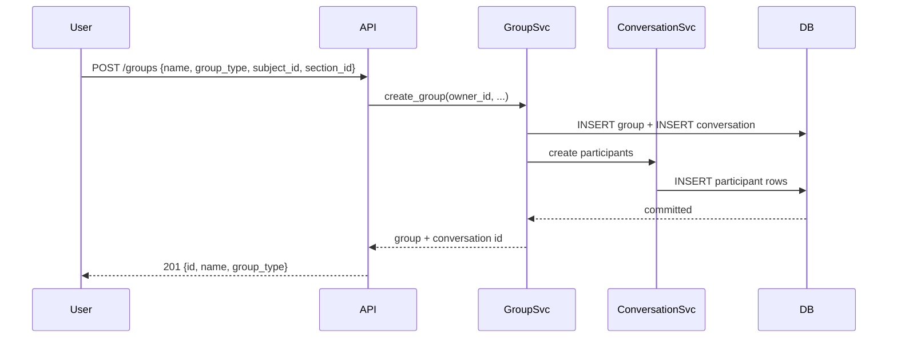
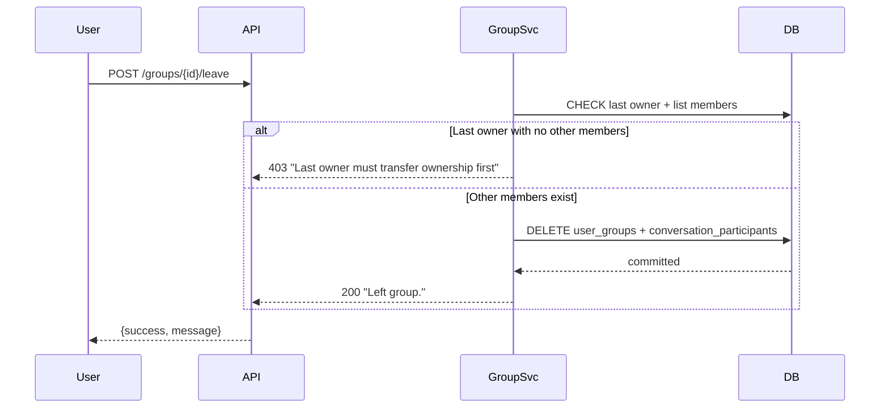
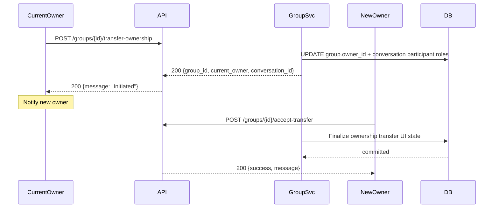

# Groups Feature

## Overview

Groups anchor the chat experience and optional per-group resource scoping in CampusVault.
A group can be tied to a subject or a section (hierarchy-aware) or be free-form (club/team).
Each group has one mirrored conversation (`conversations.type = "group"`), created in the
same transaction as the group itself.

## Models

### `groups`

| Column | Type | Description |
|---|---|---|
| `id` | UUID | Primary key |
| `name` | VARCHAR(120) | Group name |
| `description` | TEXT | Optional description |
| `group_type` | VARCHAR(32) | `subject_group` \| `section` \| `team` \| `club` |
| `owner_id` | UUID | Foreign key to `users.id` |
| `subject_id` | UUID | Foreign key to `subjects.id` (nullable) |
| `section_id` | UUID | Foreign key to `sections.id` (nullable) |
| `is_active` | BOOLEAN | Soft delete flag |

### `user_groups`

| Column | Type | Description |
|---|---|---|
| `user_id` | UUID | Primary key + FK to users |
| `group_id` | UUID | Primary key + FK to groups |
| `joined_at` | TIMESTAMP | When the user joined |
| `added_by` | UUID | Who invited the user |
| `left_at` | TIMESTAMP | When the user left (null if active) |

### `conversations` (group type)

| Column | Type | Description |
|---|---|---|
| `id` | UUID | Primary key |
| `conversation_type` | VARCHAR(16) | Always `"group"` for group chats |
| `group_id` | UUID | FK to `groups.id`, `UNIQUE` |
| `created_by` | UUID | Group creator |
| `last_message_at` | TIMESTAMP | Updated on each message |
| `is_active` | BOOLEAN | Soft delete |

### `conversation_participants` (group type)

| Column | Type | Description |
|---|---|---|
| `conversation_id` | UUID | PK + FK to conversations |
| `user_id` | UUID | PK + FK to users |
| `is_admin` | BOOLEAN | Can manage members/roles |
| `last_read_at` | TIMESTAMP | For unread count computation |

## REST API

All endpoints under `/api/v1/groups/`:

| Method | Endpoint | Description |
|---|---|---|
| `POST` | `/` | **Create group** — creator becomes owner + conversation participant |
| `GET` | `/` | **List my groups** — groups where user is a member |
| `GET` | `/{group_id}` | **Get group** — with membership check + role info |
| `POST` | `/{group_id}/members` | **Add member** — owner only; updates group + room membership |
| `POST` | `/{group_id}/leave` | **Leave group** — last owner must transfer ownership first |
| `POST` | `/{group_id}/transfer-ownership` | **Transfer ownership** — current owner initiates |
| `POST` | `/{group_id}/members/{member_id}/role` | **Change member role** — owner/moderator can promote/demote |
| `GET` | `/{group_id}/members` | **List members** — with role information |

### Response envelopes

```json
// Create / Get
{
  "success": true,
  "message": "Group loaded.",
  "data": { "id": "...", "name": "...", "description": "...", "group_type": "..." }
}

// Add member
{
  "success": true,
  "message": "Member added."
}

// Leave
{
  "success": true,
  "message": "Left group."
}
```

## Sequence Diagrams

### Create group + conversation



### Leave group (last owner must transfer first)



### Transfer ownership



## Security

| Threat | Mitigation |
|---|---|
| Unauthorized room join | Every `join_group` validates DB membership; room name never trusted |
| IDOR on group endpoints | `assert_membership()` checked on every group request |
| Last owner leaves without transferring | Server-enforced check: last owner cannot leave without other active members |
| Member removal while sockets joined | On member removal, `force_leave_room` removes sockets from `group_<id>` |
| Privilege escalation via role change | Only owners/moderators can change roles; each change audited |

## Permissions

| Action | Owner | Moderator | Member |
|---|---|---|---|
| View group | ✅ | ✅ | ✅ |
| Add members | ✅ | ❌ | ❌ |
| Remove members | ✅ | ✅ | ❌ |
| Change member role | ✅ | ✅ | ❌ |
| Leave group | ✅ | ✅ | ✅ (if not last owner) |
| Transfer ownership | ✅ | ❌ | ❌ |

## Tests

- Unit: membership rules, role transitions, leave validation, ownership transfer
- Integration: REST group CRUD flows; socket tests for join/leave authorization,
  forced leave on member removal
- Load: simulate N users joining/leaving groups, observe Redis/DB load

## Deployment Notes

- Group data is lightweight; no heavy binary blobs stored in DB
- Conversation participants table is small (one row per user per group)
- Moderator role checks use the `is_admin` flag on `conversation_participants`